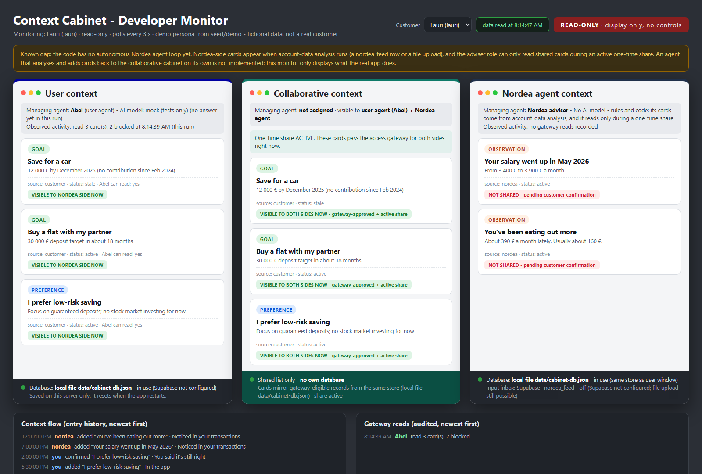

## At a glance

## At a glance

**`Instict-prototype` combines two branches:** the structured Nordea-side bank data from `Bank_database`
(stable ids, incremental imports, balance history, evidence) and the `dev-context-monitor` way of working
(the app starts with no data and you load it separately, plus a read-only developer monitor).

**1. The app ships with no data. You load it separately.**
- Nothing is built in: with no data loaded, the app shows **"No data yet"**.
- Data is loaded with [`scripts/load_data.py`](scripts/load_data.py) (CSV, JSON, JSON Lines or Excel), into
  Supabase or into the local file. The fictional demo customers (Lauri, Eeva, Alex) are in [`seed/demo/`](seed/demo).
- With Supabase set up, only Supabase counts: an empty table means an empty app.
- More → **Delete all data** empties everything (including Supabase).

**2. Structured Nordea-side bank data.**
- The feed import (`/api/import`, or a row in the `nordea_feed` table in Supabase) applies account records with
  stable ids, keeps balance history per import batch, and records the evidence for every applied row.
- Example feed row: [`supabase/nordea-feed-example.csv`](supabase/nordea-feed-example.csv). Model in detail:
  [docs/bank-records.md](docs/bank-records.md). Supabase setup: [supabase/README.md](supabase/README.md).

**3. A read-only developer monitor** at `/dev-monitor.html`, beside the app:
- Three panels: what the customer's side (Abel) can read, what is shared with Nordea right now, and Nordea's own cards.
- Which **AI model** Abel uses (and the fallback order); the Nordea adviser has no model (rules and code).
- The latest changes to the cabinet and the audited reads, refreshed every 3 seconds.
- A customer picker to watch any loaded customer.
- It only reads: watching never changes data or the access log.



*The developer monitor with the demo customer Lauri and an active one-time share (demo data, scripted test model).*

## How it differs from the other branches

| Branch | What it has |
|---|---|
| `main` | The app with demo data built in, plus the first part of the structured bank-data work (PR #4). |
| `Bank_database` | Structured Nordea-side bank data (stable ids, incremental imports, balance history, evidence) and a Supabase setup guide. |
| `dev-context-monitor` | Data loaded separately + the developer monitor. Does **not** have `Bank_database`'s bank-data work. |
| **`Instict-prototype`** (this one) | Both: separate data loading + developer monitor + the structured bank-data work. |

## Run it on your computer

**Needs:** Node.js (LTS), and Python 3.9+ to load data.

1. Install: `npm install` (if that fails, `npm install --legacy-peer-deps`).
2. Create `.env.local` in the project folder with an AI key, e.g. `GEMINI_API_KEY=...`
   (other options, such as the Aalto LLM or Groq, are in [.env.example](.env.example) and [LAPTOP.md](LAPTOP.md)).
3. Load data (the app is empty until you do):
   - With Supabase (run `supabase/setup.sql` once in Supabase → SQL Editor, and put `SUPABASE_URL` and
     `SUPABASE_SECRET_KEY` in `.env.local`):
     ```
     python scripts/load_data.py seed/demo
     ```
   - Without Supabase (saved in `data/cabinet-db.json`, which git ignores):
     ```
     python scripts/load_data.py seed/demo --target file
     ```
4. Start: `npm run dev`, then open http://localhost:3000.

If the app is already running when you load data, it picks the data up straight away (or press **Check again**
on the "No data yet" screen). Loading your own files, options like `--dry-run` / `--replace` / `--clear`, and what
each kind of record needs: [seed/README.md](seed/README.md).

**New account data** for a customer: add a row to the `nordea_feed` table in Supabase (example:
[supabase/nordea-feed-example.csv](supabase/nordea-feed-example.csv)), or upload a file in the app under
More → Nordea account data.

## Open the developer monitor

1. Add `DEV_MONITOR=1` to `.env.local` and restart the app. It is **off by default**, because it shows every card,
   private ones included. Never set it on the hosted app (AI Studio).
2. With the app running, open http://localhost:3000/dev-monitor.html in a second tab.
3. Pick the customer to watch at the top right (or add `?userId=eeva` to the address).

If it says "The developer monitor is off", the setting wasn't picked up (check the spelling, restart).
"No data loaded yet" means it works, but no data has been loaded.

## The three-database architecture

`/arch.html` is the working prototype of the agreed target: three separate data stores, one agent each, explicit agent-to-agent messages. API under `/api/arch/:userId/`, tests in `scripts/test-arch.ts` (`npm run test:arch`, 27 checks), data in `data/arch/` as one JSON file per store.

- **User DB** - the personal agent's store (profile, goals, personal facts). Abel is the in-app personal agent; connecting an external agent (e.g. Meta Muse) swaps the role, disconnecting swaps back. Nothing is deleted either way.
- **Context Memory DB** - the cabinet, the shared context between you and Nordea. Only the Context Memory agent writes it. It advises; it never changes bank data.
- **Nordea DB** - the Nordea agent's store (accounts, transactions). It proposes goal-relevant insights; you accept or reject each in merge review.

Three distinct gates: what you type to Abel goes straight into the User DB (no gate); a connected external agent's syncs (WhatsApp, calendar, notes, email) wait in the **sync airlock** for your approval; bank-side proposals wait in **merge review**. Every cabinet entry can be explained (who proposed it, why, when you approved it) and disputed. Turning an agent off, disconnecting the personal agent and deleting a store are three separate actions. The personal agent never reads the Nordea store, so it cannot state account figures, and it says plainly when it lacks context.

Run it: `npm install`, `python3 scripts/load_data.py seed/demo --target file`, `npm run dev`, then open `/arch.html`. Checks: `npm run lint`, `npm test`, `npm run check:feed`, `npm run test:arch`.

**What this prototype is not (yet):**

- The three stores are JSON files in one server process. Agent separation is a code convention (each module only calls its own store), not credential- or network-level isolation. The approved target - three real databases with separate credentials (e.g. three Supabase projects) - is not built; it needs live infrastructure and separate approval.
- The connect button is a mode selector. There is no real Meta (or any external agent) integration; `/api/arch/:uid/sync` is a stand-in HTTP endpoint where an external agent's items can be posted for the demo.
- The Nordea store is a one-time copy of the customer's loaded bank data; there is no refresh loop (delete it and it re-copies on next access). Staleness detection exists on the main app side (stale goals), not in this module.
- Retrieval is keyword overlap, not embeddings/RAG.
- Answers are deterministic templates over retrieved facts, not an LLM.

## Checks

| Command | What it does |
|---|---|
| `npm test` | Checks the bank-data model (ids, snapshot/incremental imports, balance history, evidence) on a throwaway copy. Never touches your data. |
| `npm run check:feed` | Validates `supabase/nordea-feed-example.csv` and dry-runs it twice on a throwaway copy. |
| `npm run lint` | TypeScript check. |

## Where to read more

- [docs/bank-records.md](docs/bank-records.md): the bank-data model in detail, with examples.
- [supabase/README.md](supabase/README.md): first-time Supabase setup.
- [seed/README.md](seed/README.md): loading data (formats, options, required fields).
- [docs-v14.md](docs-v14.md): how the app is built (Abel, guardrails, partner offers, sharing, saved data).
- [LAPTOP.md](LAPTOP.md): running on a laptop with the Aalto LLM (VPN).
