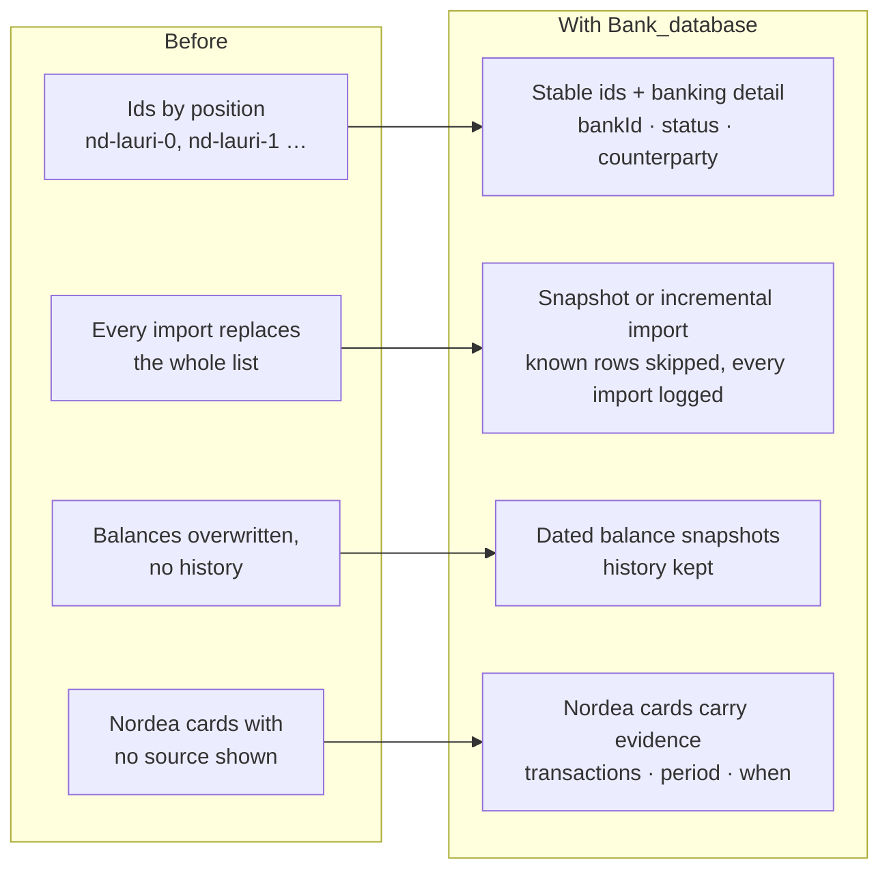

## At a glance

What this branch changes in how the Nordea-side bank data is stored.

## What this branch is for

**`Bank_database` structures the Nordea-side bank data** so it looks more like a real account statement:

- **Transactions keep banking detail**: optional `bankId`, `valueDate`, `status` (booked/pending), `currency`,
  `counterparty`, `reference`. Only stored when the data carries them, never invented.
- **Stable transaction ids** and two import modes: `snapshot` (replace the statement, the default) and
  `incremental` (merge new rows, skip ones already known, correct a pending row that got booked).
- **Explicit account records**, **dated balance snapshots** (balance history survives later imports) and an
  **import batch** record for every import.
- **Original vs enriched data**: a category from the feed is kept as given; the app's own guess is marked as such.
- **"Nordea noticed" cards carry their evidence**: which transactions, which period, when computed.
- **Supabase setup guide** and a ready-made example feed row.

The Supabase tables don't change (`abel_records`, `nordea_feed`): the new data lives in the existing JSON columns.
Full details: [docs/bank-records.md](docs/bank-records.md).

## How it differs from the other branches

| Branch | What it has |
|---|---|
| `main` | The app, plus the first part of this bank-data work (PR #4). |
| **`Bank_database`** (this one) | `main` + the rest of the bank-data work, docs, tests, example feed, Supabase guide. |
| `dev-context-monitor` | The app **starts with no data** (load it with a Python script), plus a read-only **developer monitor** page. Does not have this branch's bank-data work. |

The two feature branches both change `src/server/db.ts`, so merging them needs that file reconciled.

## Run it on your computer

**Needs:** Node.js (LTS).

1. Install: `npm install` (if that fails, `npm install --legacy-peer-deps`).
2. Create `.env.local` in the project folder with an AI key, e.g. `GEMINI_API_KEY=...`
   (other options, such as the Aalto LLM or Groq, are in [.env.example](.env.example) and [LAPTOP.md](LAPTOP.md)).
3. Start: `npm run dev`, then open http://localhost:3000.

**Data:** this branch comes with the fictional demo customers (Lauri, Eeva, Alex) built in.
- Without Supabase, the app saves to `data/cabinet-db.json` on the server (resets when the hosting restarts).
- With Supabase, follow [supabase/README.md](supabase/README.md) once. On the first start the demo customers are
  copied into the empty table; after that, Supabase is the source of truth.

**New account data** for a customer: add a row to the `nordea_feed` table in Supabase (example:
[supabase/nordea-feed-example.csv](supabase/nordea-feed-example.csv)), or upload a file in the app under
More → Nordea account data.

## Checks

| Command | What it does |
|---|---|
| `npm test` | Checks the bank-data model (ids, snapshot/incremental imports, balance history, evidence) on a throwaway copy. Never touches your data. |
| `npm run check:feed` | Validates `supabase/nordea-feed-example.csv` and dry-runs it twice on a throwaway copy. |
| `npm run lint` | TypeScript check. |

## Where to read more

- [docs/bank-records.md](docs/bank-records.md): the bank-data model in detail, with examples.
- [supabase/README.md](supabase/README.md): first-time Supabase setup.
- [docs-v14.md](docs-v14.md): how the app is built (Abel, guardrails, partner offers, sharing).
- [LAPTOP.md](LAPTOP.md): running on a laptop with the Aalto LLM (VPN).
