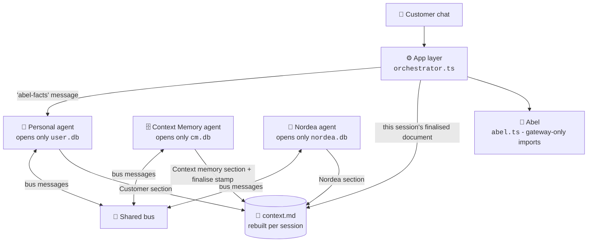

<div align="center">

# 🗄️ The Banking Context Cabinet

**Three agents, three databases, one shared document - and the customer decides what gets stored.**

*A Nordea × Aalto University mobile banking concept - `instinct-prototype-v3` branch*

[](https://nodejs.org)
[](https://www.typescriptlang.org)
[](https://nodejs.org/api/sqlite.html)
[](https://react.dev)
[](https://vite.dev)
[](https://expressjs.com)

[**Quick start**](#-quick-start) · [**The idea**](#-the-idea-in-30-seconds) · [**How a session works**](#-how-a-session-works) · [**Features**](#-features) · [**Routes**](#-routes) · [**Checks**](#-checks) · [**Known limits**](#-known-limits)

</div>

> [!NOTE]
> This branch is a **research prototype** exploring a three-agent architecture. It is not merged into `main`. All bank data, partners and customers are fictional.

## 💡 The idea in 30 seconds

Instead of one assistant reading one database, this branch splits the work between **three agents**. Each agent opens **only its own database** - that rule is enforced by a source-scan test, not by convention. Agents never read each other's stores; they talk through **bus messages** and a shared working document, **`context.md`**, that is rebuilt for every customer session.

<table>
  <tr>
    <td width="33%" valign="top">
      <h3>🙋 Personal agent</h3>
      Works for the customer. Opens <b>only the User DB</b>. Answers chat from the finished <code>context.md</code>, shares goals by title, and keeps raw detail on the customer's side.
    </td>
    <td width="33%" valign="top">
      <h3>🗄️ Context Memory agent</h3>
      Owns the cabinet. Opens <b>only the Context Memory DB</b>. Finalises each session's document, stores accepted items, and runs decay maintenance - by <i>asking</i> the other agents, never by opening their databases.
    </td>
    <td width="33%" valign="top">
      <h3>🏦 Nordea agent</h3>
      Works for Nordea. Opens <b>only the Nordea DB</b>. Answers with aggregates and proposes goal-relevant insights; raw transactions never leave its store.
    </td>
  </tr>
</table>

**Abel**, the in-app assistant, joins the same pattern: its User DB facts come from the personal agent *by message*, and it reads only the current session's finalised `context.md`. Every figure in an Abel reply must come from code or that context - otherwise the reply is sent back to be fixed.



## 🚀 Quick start

**Prerequisites:** [Git](https://git-scm.com), [Node.js](https://nodejs.org) **22.13 or newer** (the stores use the built-in `node:sqlite`), and [Python](https://www.python.org) **3** (standard library only - no `pip install` needed). Nothing else. An AI key is optional for a first look.

```bash
# 1. Get the code and switch to this branch
git clone https://github.com/coolkowkank/Nordea-x-Aalto-Banking-.git
cd Nordea-x-Aalto-Banking-
git checkout instinct-prototype-v3

# 2. Install
npm install --legacy-peer-deps

# 3. Load the fictional bank data (see seed/README.md)
python scripts/load_data.py seed/demo --target file   # local files; drop --target file for the hosted Supabase stores
# "python" not found? The command is "python3" on most Mac/Linux machines - both work.

# 4. Start it with the scripted stand-in (no key needed for a first look)
LLM_PROVIDER=mock npm run dev        # bash (Mac/Linux)
# PowerShell:   $env:LLM_PROVIDER="mock"; npm run dev
# Windows cmd:  set LLM_PROVIDER=mock && npm run dev
```

`LLM_PROVIDER=mock` is a no-key stand-in the tests use - fine for clicking around, but every answer is scripted. The normal run uses a real model: set a Gemini or Groq key (below) and start with plain `npm run dev`.

**Where to go once it is listening on port 3000:**

| Page | What it is |
|---|---|
| **http://localhost:3000/** | The main Abel app (the banking UI from `main`) |
| **http://localhost:3000/arch.html** | The three-agent demo: pick a demo customer (`alex`, `eeva` or `lauri`) in the Customer picker, add a goal, chat |
| **http://localhost:3000/dev-monitor.html** | Read-only developer monitor - only when started with `DEV_MONITOR=1` (same per-OS form as `LLM_PROVIDER` above) |

**Real AI answers (the normal run).** Copy `.env.example` to `.env` and add one free key, then restart without `LLM_PROVIDER=mock`. (`.env.example` is worded for the hosted AI Studio deployment; locally the same variable names go in `.env`, which git ignores.)

- **Gemini**: create a free key at [aistudio.google.com](https://aistudio.google.com) and set `GEMINI_API_KEY=...`.
- **Groq** (free tier): create a key at [console.groq.com](https://console.groq.com) and set `LLM_PROVIDER="openai"`, `LLM_BASE_URL="https://api.groq.com/openai/v1"`, `LLM_API_KEY=...`, `LLM_MODEL="openai/gpt-oss-120b"`.

**Troubleshooting**

- `npm run dev` exits at once or complains about `node:sqlite`: your Node is older than 22.13 - install the current LTS from [nodejs.org](https://nodejs.org).
- Port 3000 already in use: stop the other app, or run on another port - `PORT=3001 npm run dev` (bash), `$env:PORT=3001; npm run dev` (PowerShell), `set PORT=3001 && npm run dev` (cmd).
- `python` is not recognized / command not found: use `python3`; if neither exists, install Python 3 from [python.org](https://www.python.org) (no packages needed). The npm test scripts try both names automatically (via `scripts/run_python.mjs`).

Open **http://localhost:3000/arch.html** for the three-agent demo UI. Its controls: pick a customer in the **Customer** picker; chat (answered from the session's document); **New session** starts a fresh session whose next question rebuilds `context.md`; **Add goal** plus each goal's **edit**/**delete** manage the User DB goals; **Upload bank file** imports a JSON/CSV statement through the airlock; **Check feed** applies new rows of the Nordea feed CSV; the agent **off/on** switches pause one agent's reasoning; **Park** silences the whole cabinet; **Permissions** set the standing review level; **Contribute** runs a Nordea round; and the review and airlock queues take accept/reject decisions. The developer monitor at **http://localhost:3000/dev-monitor.html** is off unless you start with `DEV_MONITOR=1` (it shows private cards, so it is a laptop-only tool). Without `LLM_PROVIDER=mock`, Abel uses Gemini (`GEMINI_API_KEY`) or an OpenAI-compatible provider, as on `main`.

### Settings worth knowing

| Variable | Effect |
|---|---|
| `LLM_PROVIDER=mock` | Scripted stand-in for the models - local tests and a first look without a key |
| `LLM_GEMINI_FIRST=true` | Try Gemini before the OpenAI-compatible models (default: they answer first, Gemini is the last fallback) |
| `LLM_MAX_CALLS` | Cap on real provider HTTP calls per process; past the cap the agents run scripted and say so |
| `LLM_AGENT_MAX_STEPS` | Tool-call steps an agent's model may take per run (default 4) |
| `LLM_STEP_TIMEOUT_MS` | Timeout per model step in milliseconds (default 15000) |
| `USER_DB_URL` · `CM_DB_URL` · `NORDEA_DB_URL` | The hosted agent stores (below); unset = local SQLite |
| `SUPABASE_URL` + `SUPABASE_SECRET_KEY` | The `abel_records` plumbing table (below); unset = local file |

### Optional: hosted storage on Supabase

Local files are the default and need nothing. To host the data on [Supabase](https://supabase.com) instead:

1. Create a project and run **supabase/three-agents.sql** once in the *SQL Editor* - it makes the three agent tables and one Postgres role per agent. Give each role a letters-and-digits password: `alter role agent_user password '...';` (same for `agent_cm`, `agent_nordea`).
2. Run **supabase/setup.sql** once too (the `abel_records` table holds app plumbing: chat transcripts, logs, rewards).
3. Put the connection strings in `.env` (see `.env.example`). Use the session pooler host from Supabase -> *Connect*; the direct `db.<project>` host is unreachable on networks without IPv6:
   ```
   USER_DB_URL="postgresql://agent_user.<project-ref>:<password>@aws-0-<region>.pooler.supabase.com:5432/postgres"
   CM_DB_URL="postgresql://agent_cm.<project-ref>:<password>@aws-0-<region>.pooler.supabase.com:5432/postgres"
   NORDEA_DB_URL="postgresql://agent_nordea.<project-ref>:<password>@aws-0-<region>.pooler.supabase.com:5432/postgres"
   SUPABASE_URL="https://<project-ref>.supabase.co"
   SUPABASE_SECRET_KEY="sb_secret_..."
   ```
   Each store only ever uses its own role's URL - no service key reaches an agent path (enforced by `supabase/three-agents.sql` grants and pinned by tests).
4. Load the data without `--target file`: `python scripts/load_data.py seed/demo` writes the local agent databases and pushes them to the hosted tables (through `scripts/load_remote.ts`, each store with its own role).

At startup the app replaces its local agent databases with the hosted rows (hydrate) and flushes later writes back; if Supabase is unreachable it keeps working on the local files and logs the failure.

| Script | What it does |
|---|---|
| `npm run dev` / `npm start` | Start the server and app on port 3000 |
| `npm run build` | Build the frontend with Vite |
| `npm run lint` | Type-check with TypeScript (`tsc --noEmit`) |
| `npm test` | Run the bank-records tests |
| `npm run check:feed` | Validate the Nordea feed CSV applies cleanly |
| `npm run test:arch` | Run the three-agent architecture checks |
| `npm run test:e2e` | End-to-end proof the app, `/arch.html` and the monitor are one machine (boots a real server on a scratch dataset) |

## 🔄 How a session works

1. The customer's first question of a session opens a **build round**; `context.md` starts empty - nothing carries over from earlier sessions.
2. The **personal agent** writes the Customer section: the shareable part of the User DB (goals by title, never raw detail).
3. The **Context Memory agent** retrieves what is relevant from `cm.db` and writes the Context memory section.
4. The **Nordea agent** adds relevant aggregates from `nordea.db`.

With a provider configured (`GEMINI_API_KEY` or `LLM_PROVIDER=openai`), all three agents also **reason with an LLM**: the CM and Nordea models get tools for their own database only and propose the round's retrieval plan and match terms, and the personal agent's model reads its own User DB through tools and composes the chat reply from what it saw (any figure the model writes that is not in the selected facts or its tool results - compared as whole numbers - drops the reply back to the scripted template). Code validates every proposal and owns numbers, evidence, risk and every write. Each round record and chat answer states truthfully which path ran - `model`, `scripted`, or `scripted (model unavailable)` - and /arch.html shows it under each reply; the same status is auditable on the bus. Without a key the scripted behaviour runs unchanged (that is also what the tests use).
5. The Context Memory agent **finalises** the document and stamps it with the session id. Every later question in that session is answered from that document.
6. If an agent is off or the cabinet is parked, no round runs and no other session's document is served - the app says plainly that shared context is unavailable.
7. Accepted knowledge is stored in `cm.db`; decay maintenance re-checks it before reuse (below).

## ✨ Features

#### 🗂️ The shared document

| | Feature | How it works |
|:-:|---|---|
| 📄 | **Per-session `context.md`** | Rebuilt for every customer session, rendered from structured rows - never parsed back. |
| ✍️ | **Section ownership, enforced** | One writer module per section; the same source-scan that pins each agent to its own database pins the sections. |
| 🔎 | **Session stamping** | A document is served only when its `sessionId` matches the current session; a stale document is never wiped and never leaked across sessions. |

#### 🚦 Risk and permissions

| | Feature | How it works |
|:-:|---|---|
| 📏 | **Risk decided by code rules** | High risk always waits for the customer: offers, sharing beyond the three agents, inferences, sensitive topics. Never the agent's judgement. |
| 🧾 | **Observed vs inferred, derived** | "Observed" comes from the evidence (transaction ids + a total, or the customer's own words) - never trusted from the proposer's own flag. |
| 🎚️ | **Standing permissions** | Set once via `POST /api/arch/:uid/permissions`. Until then every proposal waits in merge review; afterwards low and medium risk items are stored automatically - always logged, explainable and disputable. |

#### ⏳ Decay maintenance

| | Feature | How it works |
|:-:|---|---|
| 🔁 | **Re-check before reuse** | The CM agent detects possible decay from stored evidence and asks the owning agent to confirm - it never opens another agent's database. |
| 🧮 | **Five decay signals** | A changed total; churned transactions (a hash of the full id set is compared like with like, so large accounts don't false-flag); age past 30 days without verifiable evidence; evidence that was never stored; and a goal the customer removed, which flags its entries too. |
| 🚩 | **Plain-language flags** | The customer is told which entries went stale, why, and whether refreshed figures were stored automatically or wait in merge review. |

#### 🧑‍⚖️ Customer control

| | Feature | How it works |
|:-:|---|---|
| 💬 | **Explain** | Every cabinet item answers "why do you know this?" with its source and the message that proposed it. |
| ✋ | **Dispute** | The customer can mark an item wrong; from then on it is filtered out of the context Abel receives, so its figures fail Abel's grounding check. The stored document keeps the `[disputed]` mark and the history. |
| ↩️ | **Undo** | Automatically stored items can be undone per entry; manually reviewed items are disputed instead, so provenance survives. |
| ⏸️ | **Park and agent switches** | Parking the cabinet or switching an agent off silences that part of the pipeline without deleting anything. An off switch gates the agent's **reasoning** only - control writes from the app still land in its database. |

#### 💬 Abel, inside the architecture

| | Feature | How it works |
|:-:|---|---|
| 📨 | **Facts by message** | Abel's User DB facts come from the personal agent answering an `abel-facts` message - the app layer opens no agent store on this path (pinned by a source-scan test). |
| 📄 | **Session document only** | Abel receives the current session's finalised `context.md`; a missing or other-session document is rebuilt when possible and otherwise not served. |
| 🔢 | **Grounded numbers** | Figures from the shared context join the same grounding guard as tool results: a number Abel can't source sends the reply back to be fixed. |

## 🛣️ Routes

Under `/api/arch/` (`src/server/arch/routes.ts`; `:uid` = the customer):

| Route | Purpose |
|---|---|
| `GET customers` | The customers with agent data (the demo UI's picker) |
| `GET :uid/state` | Cabinet, agents and document state for the demo UI |
| `POST :uid/session/new` | Start a fresh session; the next question rebuilds the document |
| `POST :uid/chat` | Session chat answered from the session's document |
| `POST :uid/goals` · `POST :uid/goals/:goalId` · `POST :uid/goals/:goalId/delete` | Add, edit and delete customer goals |
| `POST :uid/permissions` | Set standing permissions (`reviewLevel: 'all' \| 'high'`) |
| `POST :uid/agent-query` | Ask an agent a direct question |
| `POST :uid/airlock/:batchId/approve` · `POST :uid/airlock/:batchId/reject` | Approve or reject what enters the User DB |
| `POST :uid/nordea/contribute` | Run a contribution round (Nordea proposals) |
| `GET :uid/review` · `POST :uid/review/:messageId/accept` · `POST :uid/review/:messageId/reject` | The merge-review queue |
| `GET :uid/entries` · `GET :uid/entries/:entryId/explain` · `POST :uid/entries/:entryId/dispute` · `POST :uid/entries/:entryId/undo` | Cabinet entries: list, explain, dispute, undo |
| `POST :uid/cabinet/park` · `POST :uid/cabinet/resume` | Park or resume the whole cabinet |
| `POST :uid/agents/:agent/off` · `POST :uid/agents/:agent/on` | Switch one agent off or on |
| `DELETE :uid/db/:which` | Delete a database (customer-driven) |

App-level routes the demo surfaces use (`src/server/routes.ts`, `src/server/devMonitor.ts`):

| Route | Purpose |
|---|---|
| `GET /api/dev/monitor` | The developer monitor's read-only view (only with `DEV_MONITOR=1`) |
| `GET` · `POST /api/nordea-data` · `POST /api/nordea-data/check` | The Nordea feed: inspect, apply, and check for new rows (the **Check feed** button) |
| `POST /api/import` | Import a bank file through the airlock (the **Upload bank file** button) |

## ✅ Checks

| Check | Command | Covers |
|---|---|---|
| Architecture tests | `npm run test:arch` | 225 assertions: the one-database rule (source scan), per-session documents, reactive rounds, risk rules, permissions, decay, undo, the Abel integration, the G4 LLM planning path (mock provider) and the negative cases |
| End-to-end | `npm run test:e2e` | 21 checks over a real booted server: a goal shows in all views, a review decision changes what the chat answers from, a bank import updates app + arch + monitor, session and top-up rounds run, and no code reads the old store |
| Data-layer adapter | `npm run test:adapter` | 43 checks: the old app store as an adapter over the three agent databases, legacy migration, and plumbing separation |
| Hosted sync | `npm run test:remote` | 13 checks against an in-memory Postgres double: hydrate, flush, failures, and the one-role-per-agent grants |
| review.md guard | `npm run check:review` | Keeps every review.md message inside the collaboration format |
| Type check | `npm run lint` | `tsc --noEmit` across the app |
| Bank records | `npm test` | Feed loading and bank-record maths |
| Feed CSV | `npm run check:feed` | The Nordea feed CSV applies cleanly |

## ⚠️ Known limits

<details>
<summary>What this prototype does <b>not</b> do</summary>

- **Figures are labelled "of related spending"** - goal matching uses category and description keywords, so a saving goal's figure is the related spending, not a true savings-transfer balance.
- **Single process.** The round engine, bus and stores run in one Node process; `node:sqlite` files sit under the data dir. No distribution, no queues.
- **No live bank.** All account data is fictional, loaded with `scripts/load_data.py` (see `seed/README.md`).
- **Demo UI.** `public/arch.html` and `public/dev-monitor.html` are demonstration surfaces, not the polished app from `main`.
- **Hosted mode is hydrate-then-flush.** With the Supabase role URLs set, the hosted tables replace the local agent databases at startup and writes flush back; if Supabase is unreachable the app keeps working on the local files (the honest fallback copy) and logs the failure.

</details>

<details>
<summary>📁 Project structure (this branch adds <code>src/server/arch</code>)</summary>

```
src/server/arch/
  agents/       personal.ts · cm.ts · nordea.ts (each opens only its own store)
  store/        userStore · cmStore · nordeaStore · contextStore · busStore (node:sqlite)
                remote.ts - the hosted Supabase sync (one role URL per store)
  orchestrator.ts  rounds, sessions, decay maintenance, Abel shared context
  rounds.ts        round engine        dispatcher.ts   bus delivery
  llm.ts           the agents' model runs (tools, step limits, timeouts)
  types.ts         the shared architecture types
  risk.ts          code-rule risk levels
  text.ts          keyword and category matching
  routes.ts        /api/arch/:uid/* HTTP surface
supabase/
  setup.sql        the abel_records table (app plumbing)
  three-agents.sql the three hosted agent tables + one Postgres role per agent
public/
  arch.html        three-agent demo UI
  dev-monitor.html developer monitor
scripts/
  test-arch.ts     the architecture assertions (count in the Checks table)
  load_data.py     fictional bank data loader (see seed/README.md)
  load_remote.ts   pushes the local agent databases to the hosted tables (load_data.py calls it)
  run_python.mjs   runs Python as "python" or "python3", whichever the machine has
```

The main Abel app (`src/server/abel.ts`, cabinet UI, access gateway) is shared with `main`; this branch wires Abel's chat into the three-agent context described above.

</details>
