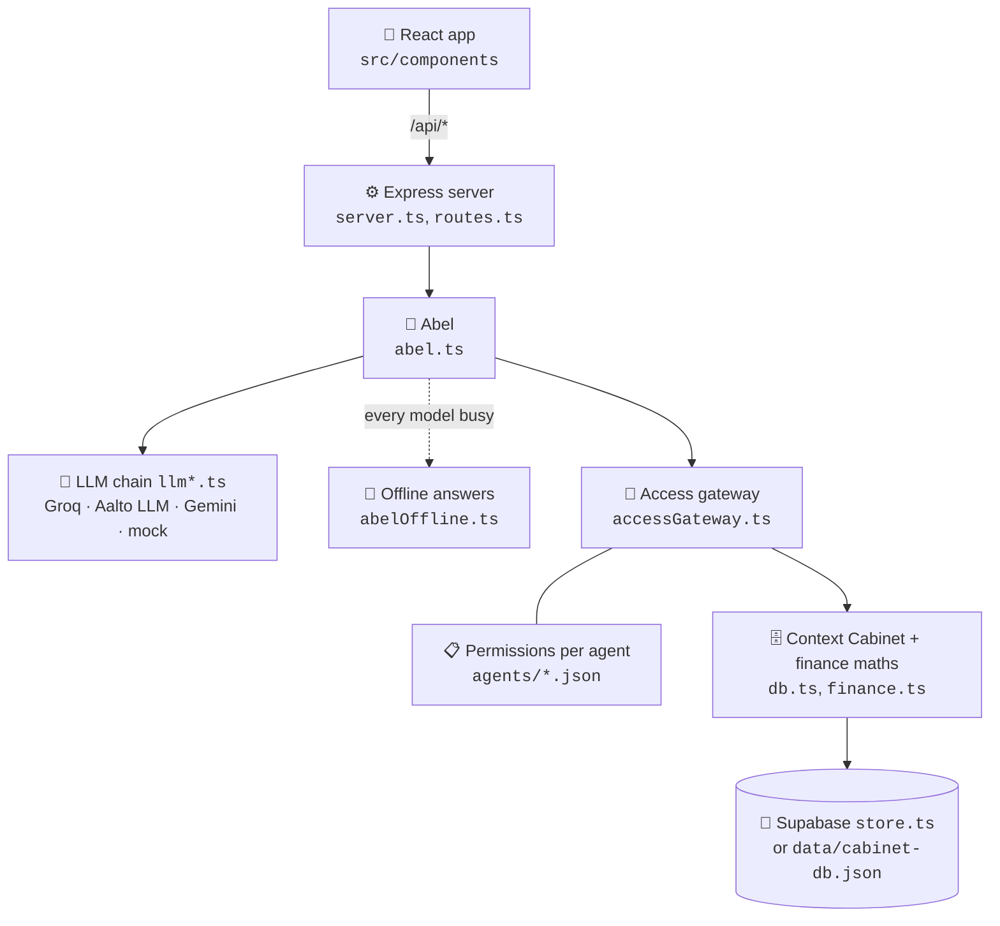

<div align="center">

# 🗄️ The Banking Context Cabinet

**Chat with your bank. Decide exactly what it knows about you.**

*A Nordea × Aalto University mobile banking concept*

[](https://react.dev)
[](https://www.typescriptlang.org)
[](https://vite.dev)
[](https://tailwindcss.com)
[](https://expressjs.com)
[](https://supabase.com)
[](https://ai.google.dev)

[**Quick start**](#-quick-start) · [**Features**](#-what-it-does) · [**How it works**](#-how-it-works) · [**Branches**](#-branches) · [**Configuration**](#%EF%B8%8F-configuration) · [**Docs**](#-further-docs)

<br>


</div>

> [!NOTE]
> This is a **research prototype**. All bank data, partners and customers in it are fictional.

## 💡 The idea in 30 seconds

Customers chat with **Abel**, an AI banking assistant. Everything Abel knows lives in a **Context Cabinet** the customer controls, and every read goes through a logged **access gateway**.

<table>
  <tr>
    <td width="33%" valign="top">
      <h3>💬 Abel</h3>
      Answers questions about balances, spending, goals and payday plans. <b>Numbers come from code</b>, not from the model's imagination.
    </td>
    <td width="33%" valign="top">
      <h3>🗄️ Context Cabinet</h3>
      One place for everything Abel knows. Each item shows <b>where it came from</b> and its full history.
    </td>
    <td width="33%" valign="top">
      <h3>🔐 Access gateway</h3>
      Every read by any helper is <b>checked against the customer's permissions</b> and logged in <i>Who sees it</i>.
    </td>
  </tr>
</table>

Demo personas: **Lauri**, **Eeva** and **Alex**.

## 📱 Screenshots

<table>
  <tr>
    <td align="center"><br><sub><b>Home</b></sub></td>
    <td align="center"><br><sub><b>Home, scrolled</b></sub></td>
    <td align="center"><br><sub><b>Context Cabinet</b></sub></td>
    <td align="center"><br><sub><b>Chat with Abel</b></sub></td>
  </tr>
</table>

<details>
<summary>🌙 Dark mode</summary>
<br>
<table>
  <tr>
    <td align="center"><br><sub><b>Home</b></sub></td>
    <td align="center"><br><sub><b>Chat with Abel</b></sub></td>
  </tr>
</table>
</details>

## 🚀 Quick start

**You need:** [Node.js](https://nodejs.org) LTS. An AI key is optional for a first look.

```bash
# 1. Get the code
git clone https://github.com/coolkowkank/Nordea-x-Aalto-Banking-.git
cd Nordea-x-Aalto-Banking-

# 2. Install
npm install --legacy-peer-deps

# 3. Add your AI key (see Configuration below)
cp .env.example .env

# 4. Run
npm run dev
```

Then open **http://localhost:3000** and check the connection under **More → AI connection → Test**.

> [!TIP]
> **No AI key yet?** Start with the scripted stand-in instead of step 3:
> ```bash
> LLM_PROVIDER=mock npm run dev
> ```

| Script | What it does |
|---|---|
| `npm run dev` / `npm start` | Start the server and app on port 3000 |
| `npm run build` | Build the frontend with Vite |
| `npm run lint` | Type-check with TypeScript |
| `npm test` | Run the bank-records tests |

## ✨ What it does

#### 🧠 Ask and understand

| | Feature | What the customer gets |
|:-:|---|---|
| 💬 | **Abel, the AI assistant** | Answers about balances, spending, goals and payday plans. Numbers come from code. |
| 🛡️ | **Safe actions** | Money never moves from chat. Abel can only propose a transfer; the customer confirms it. |

#### 🔐 Stay in control

| | Feature | What the customer gets |
|:-:|---|---|
| 🗄️ | **Context Cabinet** | Goals, life events, preferences, facts and Nordea's observations, each with source and history. |
| 🚦 | **Access gateway** | Reads by Abel, the partner-offer helper or a Nordea adviser are permission-checked and logged in *Who sees it*. |
| ⏳ | **One-time sharing** | Share with a Nordea adviser for a limited time, and revoke at any moment. |

#### 📥 Bring your data in

| | Feature | What the customer gets |
|:-:|---|---|
| 📎 | **Import** | WhatsApp chats, PDFs, photos, Excel and CSV. Abel suggests what to save; the customer ticks what to keep. |
| 📄 | **Your documents** | Files are read once and not kept, unless the customer chooses *Keep a copy* (auto-deleted after 30 days). |
| 🏦 | **Nordea account data** | Upload or feed fictional account data; Nordea spots salary changes, spending shifts and new regular payments for the customer to confirm. |

#### 🎁 Get value back

| | Feature | What the customer gets |
|:-:|---|---|
| 🤝 | **Partner offers** | Fictional partners (homes, movers, energy, insurance, planning) appear only when relevant and allowed. The fee is always shown, and part of it goes back to the customer. |
| ⭐ | **Data rewards** | Fictional points for sharing notes and for each time a helper actually uses them. |

## 🧭 How it works



### 🛡️ Guardrails built into the code

| # | Rule |
|:-:|---|
| 1 | Abel reads the cabinet **through the gateway** before every reply. |
| 2 | Every number in a reply must come from a tool or the cabinet; otherwise the reply is **sent back to be fixed**. |
| 3 | The cabinet changes only through a **proposal the customer can undo**, with provenance recorded. |
| 4 | Partner offers come **only from the registry**, never when turned off, and at most once per partner per chat. |
| 5 | *Based on N things* lists **only what the gateway actually returned** in that turn. |

## 🧰 Tech stack

| Layer | Tools |
|---|---|
| 🎨 Frontend | React 19, Vite 8, Tailwind CSS 4, Motion, Lucide icons |
| ⚙️ Backend | Node.js, Express, TypeScript (run with `tsx`) |
| 🤖 AI | Google Gemini (`@google/genai`), any OpenAI-compatible API (Groq, Aalto LLM gateway), scripted mock |
| 💾 Storage | Supabase (Postgres + private file bucket), or a local JSON file |
| 📄 File reading | `unpdf` (PDF), `read-excel-file` (Excel) |
| ☁️ Hosting | Google AI Studio (Cloud Run) |

## ⚙️ Configuration

Put settings in `.env` on a laptop, or in **AI Studio → Settings → Secrets**.

> [!WARNING]
> Never commit keys. `.env` is ignored by git.

### Pick an AI provider

| Provider | Best for | Needs |
|---|---|---|
| **Gemini** | Default, and AI Studio | `GEMINI_API_KEY` |
| **Groq** | Free option, works in AI Studio | `LLM_PROVIDER=openai` + Groq key |
| **Aalto LLM** | Laptop on the Aalto VPN | `LLM_PROVIDER=openai` + Aalto key · [step-by-step guide](LAPTOP.md) |
| **Mock** | Local tests, no key | `LLM_PROVIDER=mock` |

<details>
<summary><b>Example <code>.env</code> for Groq</b></summary>

```env
LLM_PROVIDER=openai
LLM_BASE_URL=https://api.groq.com/openai/v1
LLM_API_KEY=your-groq-key
LLM_MODEL=openai/gpt-oss-120b
```
If that model hits its limit, Abel tries `qwen/qwen3.8-27b`, then `openai/gpt-oss-20b`, then Gemini (if `GEMINI_API_KEY` is set). Override the backups with `LLM_FALLBACK_MODELS`.
</details>

<details>
<summary><b>Example <code>.env</code> for the Aalto LLM</b></summary>

```env
LLM_PROVIDER=openai
LLM_BASE_URL=https://llm-gateway.k8s.aalto.fi/api/v1
LLM_API_KEY=your-aalto-key
LLM_MODEL=Qwen/Qwen3.8-27B-FP8
LLM_TIMEOUT_MS=90000
LLM_TURN_MS=150000
```
</details>

<details>
<summary><b>All environment variables</b></summary>
<br>

| Variable | Required | Purpose |
|---|---|---|
| `GEMINI_API_KEY` | Yes, for Gemini | Gemini API key (injected automatically in AI Studio) |
| `APP_URL` | AI Studio only | URL where the app is hosted |
| `GEMINI_MODEL` | No | Gemini model to use (default `gemini-3.8-flash`) |
| `LLM_PROVIDER` | No | `openai` for Groq or the Aalto LLM, `mock` for local tests only |
| `LLM_BASE_URL` | With `openai` | API address, e.g. `https://api.groq.com/openai/v1` |
| `LLM_API_KEY` | With `openai` | API key for that service |
| `LLM_MODEL` | With `openai` | First model to try |
| `LLM_FALLBACK_MODELS` | No | Comma-separated backup models |
| `LLM_VISION_MODELS` | No | Models that can read photos |
| `LLM_TIMEOUT_MS`, `LLM_TURN_MS` | No | Time limits for one call and a whole reply |
| `SUPABASE_URL`, `SUPABASE_SECRET_KEY` | No | Save data in Supabase instead of the local file (needed on AI Studio, where the file resets on restart) |

</details>

### 💾 Saving data in Supabase (optional)

Without Supabase, data is saved in `data/cabinet-db.json`. On a laptop that file persists between runs; on AI Studio it resets whenever the app restarts. To keep data on AI Studio:

1. Run `supabase/setup.sql` once in the Supabase SQL Editor.
2. For the account-data feed, also run `supabase/nordea-feed.sql`.
3. Add `SUPABASE_URL` and `SUPABASE_SECRET_KEY` as secrets.

## 🧪 Testing

- **`npm test`** runs the bank-records tests.
- **In the app:** **More → Check Abel's answers** asks 12 real questions on a copy of Lauri and grades them automatically.

## 📁 Project structure

<details>
<summary>Show the file tree</summary>

```
├── server.ts                 Express entry point (port 3000)
├── src/
│   ├── App.tsx, main.tsx     React app
│   ├── components/           Home, Chat, Pages (cabinet, sharing, rewards, settings), modals
│   ├── server/
│   │   ├── abel.ts           Abel's prompt, tools and guardrails
│   │   ├── llm*.ts           Model providers and fallback chain
│   │   ├── abelOffline.ts    Code-based answers when no model is free
│   │   ├── accessGateway.ts  Permission checks and access log
│   │   ├── finance.ts        All numbers: balances, spending, goals, fees
│   │   ├── routes.ts         API routes
│   │   ├── db.ts, store.ts   In-memory data + Supabase sync
│   │   ├── documents.ts      Uploaded files (read once / keep 30 days)
│   │   ├── nordeaData.ts     Account data and Nordea observations
│   │   └── dataRewards.ts    Points for sharing and use
│   ├── services/api.ts       Frontend API client
│   └── types.ts              Shared types
├── agents/                   What each helper may read (abel, offers, adviser)
├── partners/                 Fictional partner definitions
├── data/cabinet-db.json      Local demo data
├── supabase/                 SQL setup scripts
├── scripts/                  Tests
├── public/                   Fonts, screenshots and design assets
└── docs/, docs-v14.md        Design and change notes
```
</details>

## 🌿 Branches

`main` is the stable app. Two feature branches build on it:

| Branch | What it adds | Start here |
|---|---|---|
| **`main`** | The app with demo data built in, including the structured bank-data model (stable transaction ids, incremental imports, balance history, evidence for observations). | This README · [`docs/bank-records.md`](docs/bank-records.md) |
| [**`Bank_database`**](https://github.com/coolkowkank/Nordea-x-Aalto-Banking-/tree/Bank_database) | 🏦 Docs and tooling for that bank data: a Supabase setup guide, an example feed CSV, and `npm run check:feed`, a dry run that checks a feed CSV before you upload it. The app code is the same as `main`. | [`supabase/README.md`](https://github.com/coolkowkank/Nordea-x-Aalto-Banking-/blob/Bank_database/supabase/README.md) |
| [**`dev-context-monitor`**](https://github.com/coolkowkank/Nordea-x-Aalto-Banking-/tree/dev-context-monitor) | 🔍 The app ships empty and data is loaded separately with `scripts/load_data.py` (needs Python 3.9+). Adds a read-only developer monitor at `/dev-monitor.html` that shows live what Abel can read, what is shared with Nordea, and every audited read. Turn it on with `DEV_MONITOR=1`, on a laptop only. | [`seed/README.md`](https://github.com/coolkowkank/Nordea-x-Aalto-Banking-/blob/dev-context-monitor/seed/README.md) |

> [!IMPORTANT]
> `dev-context-monitor` rewrites `src/server/db.ts` and does not include the structured bank-data changes that `main` has, so merging it into `main` needs that file reconciled.

## 📚 Further docs

| Doc | Read it to learn |
|---|---|
| [docs-v14.md](docs-v14.md) | How Abel, the gateway, storage, documents and data rewards work |
| [docs/bank-records.md](docs/bank-records.md) | Structure of the Nordea account data |
| [LAPTOP.md](LAPTOP.md) | Running with the Aalto LLM on a laptop |

## ✍️ About this README

Written by two AI agents working together on the branch `ai-agent-communications`. Their conversation is in [AGENT_CHAT.md](AGENT_CHAT.md).

| Agent | Role | Signature |
|---|---|---|
| **Jeff** (Claude) | Content and accuracy | ✍️ *Jeff was here: first draft, every claim checked against the code.* |
| **Bill** | Design and readability | ✍️ *Bill was here: layout, badges, gallery, diagrams and tables, so it reads in one minute and runs in five.* |

---

<div align="center">
<sub>Built as a <b>Nordea × Aalto University</b> research prototype. All data is fictional.</sub>
</div>
