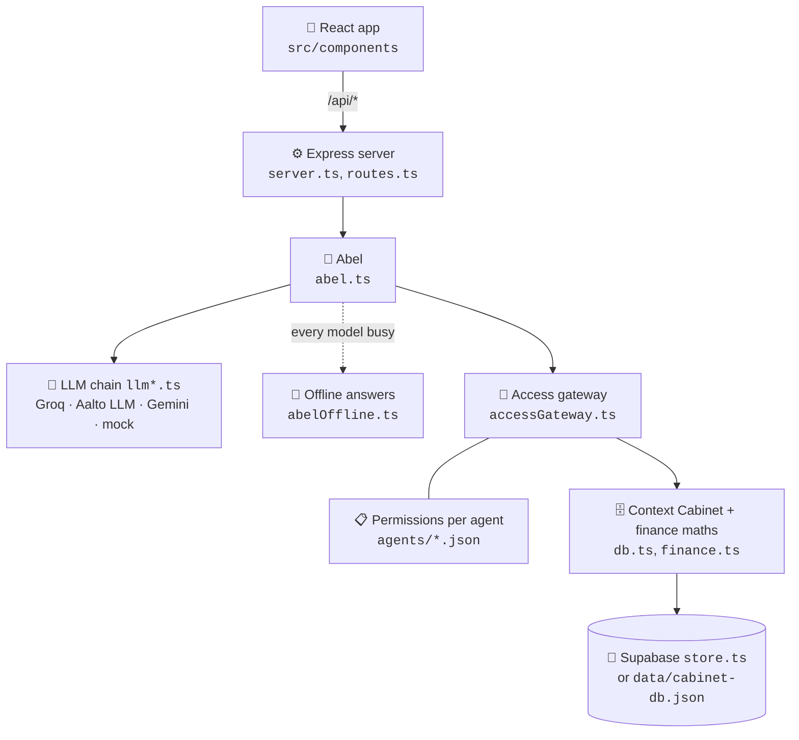
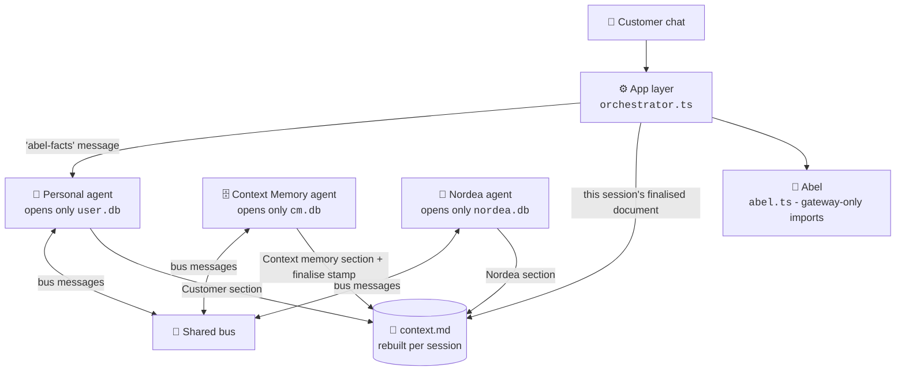

<div align="center">

# 🗄️ The Banking Context Cabinet

**Chat with your bank. Decide exactly what it knows about you.**

*A Nordea × Aalto University mobile banking concept*

[](https://react.dev)
[](https://www.typescriptlang.org)
[](https://vite.dev)
[](https://tailwindcss.com)
[](https://expressjs.com)
[](https://supabase.com)
[](https://ai.google.dev)

[**Quick start**](#-quick-start) · [**Features**](#-what-it-does) · [**How it works**](#-how-it-works) · [**Three-agent architecture**](#-three-agent-architecture) · [**Branches**](#-branches) · [**Configuration**](#%EF%B8%8F-configuration) · [**Docs**](#-further-docs)

<br>


</div>

> [!NOTE]
> This is a **research prototype**. All bank data, partners and customers in it are fictional.

## 💡 The idea in 30 seconds

Customers chat with **Abel**, an AI banking assistant. Everything Abel knows lives in a **Context Cabinet** the customer controls, and every read goes through a logged **access gateway**.

<table>
  <tr>
    <td width="33%" valign="top">
      <h3>💬 Abel</h3>
      Answers questions about balances, spending, goals and payday plans. <b>Numbers come from code</b>, not from the model's imagination.
    </td>
    <td width="33%" valign="top">
      <h3>🗄️ Context Cabinet</h3>
      One place for everything Abel knows. Each item shows <b>where it came from</b> and its full history.
    </td>
    <td width="33%" valign="top">
      <h3>🔐 Access gateway</h3>
      Every read by any helper is <b>checked against the customer's permissions</b> and logged in <i>Who sees it</i>.
    </td>
  </tr>
</table>

Demo personas: **Lauri**, **Eeva** and **Alex**.

## 📱 Screenshots

<table>
  <tr>
    <td align="center"><br><sub><b>Home</b></sub></td>
    <td align="center"><br><sub><b>Home, scrolled</b></sub></td>
    <td align="center"><br><sub><b>Context Cabinet</b></sub></td>
    <td align="center"><br><sub><b>Chat with Abel</b></sub></td>
  </tr>
</table>

<details>
<summary>🌙 Dark mode</summary>
<br>
<table>
  <tr>
    <td align="center"><br><sub><b>Home</b></sub></td>
    <td align="center"><br><sub><b>Chat with Abel</b></sub></td>
  </tr>
</table>
</details>

## 🚀 Quick start

**You need:** [Node.js](https://nodejs.org) 22.13 or newer (the three-agent stores use the built-in `node:sqlite`, unflagged from 22.13) and Python 3.9+ to load the demo data. An AI key is optional for a first look.

```bash
# 1. Get the code
git clone https://github.com/coolkowkank/Nordea-x-Aalto-Banking-.git
cd Nordea-x-Aalto-Banking-

# 2. Install
npm install --legacy-peer-deps

# 3. Load the fictional bank data (see seed/README.md)
python3 scripts/load_data.py seed/demo --target file   # local file store; drop --target file to use Supabase

# 4. Add your AI key (see Configuration below)
cp .env.example .env

# 5. Run
npm run dev
```

Then open **http://localhost:3000** and check the connection under **More → AI connection → Test**. The three-agent demo is at **http://localhost:3000/arch.html**; the developer monitor at **http://localhost:3000/dev-monitor.html** is off unless you start with `DEV_MONITOR=1` (it shows private cards, so it is a laptop-only tool).

> [!TIP]
> **No AI key yet?** Start with the scripted stand-in instead of step 4:
> ```bash
> LLM_PROVIDER=mock npm run dev
> ```

| Script | What it does |
|---|---|
| `npm run dev` / `npm start` | Start the server and app on port 3000 |
| `npm run build` | Build the frontend with Vite |
| `npm run lint` | Type-check with TypeScript |
| `npm test` | Run the bank-records tests |
| `npm run test:arch` | Run the three-agent architecture checks |
| `npm run check:feed` | Dry-run the example Nordea feed CSV |

## ✨ What it does

#### 🧠 Ask and understand

| | Feature | What the customer gets |
|:-:|---|---|
| 💬 | **Abel, the AI assistant** | Answers about balances, spending, goals and payday plans. Numbers come from code. |
| 🛡️ | **Safe actions** | Money never moves from chat. Abel can only propose a transfer; the customer confirms it. |

#### 🔐 Stay in control

| | Feature | What the customer gets |
|:-:|---|---|
| 🗄️ | **Context Cabinet** | Goals, life events, preferences, facts and Nordea's observations, each with source and history. |
| 🚦 | **Access gateway** | Reads by Abel, the partner-offer helper or a Nordea adviser are permission-checked and logged in *Who sees it*. |
| ⏳ | **One-time sharing** | Share with a Nordea adviser for a limited time, and revoke at any moment. |

#### 📥 Bring your data in

| | Feature | What the customer gets |
|:-:|---|---|
| 📎 | **Import** | WhatsApp chats, PDFs, photos, Excel and CSV. Abel suggests what to save; the customer ticks what to keep. |
| 📄 | **Your documents** | Files are read once and not kept, unless the customer chooses *Keep a copy* (auto-deleted after 30 days). |
| 🏦 | **Nordea account data** | Upload or feed fictional account data; Nordea spots salary changes, spending shifts and new regular payments for the customer to confirm. |

#### 🎁 Get value back

| | Feature | What the customer gets |
|:-:|---|---|
| 🤝 | **Partner offers** | Fictional partners (homes, movers, energy, insurance, planning) appear only when relevant and allowed. The fee is always shown, and part of it goes back to the customer. |
| ⭐ | **Data rewards** | Fictional points for sharing notes and for each time a helper actually uses them. |

## 🧭 How it works



### 🛡️ Guardrails built into the code

| # | Rule |
|:-:|---|
| 1 | Abel reads the cabinet **through the gateway** before every reply. |
| 2 | Every number in a reply must come from a tool or the cabinet; otherwise the reply is **sent back to be fixed**. |
| 3 | The cabinet changes only through a **proposal the customer can undo**, with provenance recorded. |
| 4 | Partner offers come **only from the registry**, never when turned off, and at most once per partner per chat. |
| 5 | *Based on N things* lists **only what the gateway actually returned** in that turn. |

## 🧰 Tech stack

| Layer | Tools |
|---|---|
| 🎨 Frontend | React 19, Vite 8, Tailwind CSS 4, Motion, Lucide icons |
| ⚙️ Backend | Node.js, Express, TypeScript (run with `tsx`) |
| 🤖 AI | Google Gemini (`@google/genai`), any OpenAI-compatible API (Groq, Aalto LLM gateway), scripted mock |
| 💾 Storage | Supabase (Postgres + private file bucket) or a local JSON file for the app; `node:sqlite` per-customer stores for the three-agent architecture |
| 📄 File reading | `unpdf` (PDF), `read-excel-file` (Excel) |
| ☁️ Hosting | Google AI Studio (Cloud Run) |

## ⚙️ Configuration

Put settings in `.env` on a laptop, or in **AI Studio → Settings → Secrets**.

> [!WARNING]
> Never commit keys. `.env` is ignored by git.

### Pick an AI provider

| Provider | Best for | Needs |
|---|---|---|
| **Gemini** | Default, and AI Studio | `GEMINI_API_KEY` |
| **Groq** | Free option, works in AI Studio | `LLM_PROVIDER=openai` + Groq key |
| **Aalto LLM** | Laptop on the Aalto VPN | `LLM_PROVIDER=openai` + Aalto key · [step-by-step guide](LAPTOP.md) |
| **Mock** | Local tests, no key | `LLM_PROVIDER=mock` |

<details>
<summary><b>Example <code>.env</code> for Groq</b></summary>

```env
LLM_PROVIDER=openai
LLM_BASE_URL=https://api.groq.com/openai/v1
LLM_API_KEY=your-groq-key
LLM_MODEL=openai/gpt-oss-120b
```
If that model hits its limit, Abel tries `qwen/qwen3.8-27b`, then `openai/gpt-oss-20b`, then Gemini (if `GEMINI_API_KEY` is set). Override the backups with `LLM_FALLBACK_MODELS`.
</details>

<details>
<summary><b>Example <code>.env</code> for the Aalto LLM</b></summary>

```env
LLM_PROVIDER=openai
LLM_BASE_URL=https://llm-gateway.k8s.aalto.fi/api/v1
LLM_API_KEY=your-aalto-key
LLM_MODEL=Qwen/Qwen3.8-27B-FP8
LLM_TIMEOUT_MS=90000
LLM_TURN_MS=150000
```
</details>

<details>
<summary><b>All environment variables</b></summary>
<br>

| Variable | Required | Purpose |
|---|---|---|
| `GEMINI_API_KEY` | Yes, for Gemini | Gemini API key (injected automatically in AI Studio) |
| `APP_URL` | AI Studio only | URL where the app is hosted |
| `GEMINI_MODEL` | No | Gemini model to use (default `gemini-3.8-flash`) |
| `LLM_PROVIDER` | No | `openai` for Groq or the Aalto LLM, `mock` for local tests only |
| `LLM_BASE_URL` | With `openai` | API address, e.g. `https://api.groq.com/openai/v1` |
| `LLM_API_KEY` | With `openai` | API key for that service |
| `LLM_MODEL` | With `openai` | First model to try |
| `LLM_FALLBACK_MODELS` | No | Comma-separated backup models |
| `LLM_VISION_MODELS` | No | Models that can read photos |
| `LLM_TIMEOUT_MS`, `LLM_TURN_MS` | No | Time limits for one call and a whole reply |
| `SUPABASE_URL`, `SUPABASE_SECRET_KEY` | No | Save data in Supabase instead of the local file (needed on AI Studio, where the file resets on restart) |

</details>

### 💾 Saving data in Supabase (optional)

Without Supabase, data is saved in `data/cabinet-db.json`. On a laptop that file persists between runs; on AI Studio it resets whenever the app restarts. To keep data on AI Studio:

1. Run `supabase/setup.sql` once in the Supabase SQL Editor.
2. For the account-data feed, also run `supabase/nordea-feed.sql`.
3. Add `SUPABASE_URL` and `SUPABASE_SECRET_KEY` as secrets.

## ✅ Testing

- **`npm test`** runs the bank-records tests.
- **`npm run test:arch`** runs the 188 architecture assertions: the one-database rule (enforced by a source scan), per-session documents, rounds, risk rules, permissions, decay, undo, and the Abel integration with its negative cases.
- **`npm run check:feed`** dry-runs the example Nordea feed CSV.
- **In the app:** **More → Check Abel's answers** asks 12 real questions on a copy of Lauri and grades them automatically.

## 📁 Project structure

<details>
<summary>Show the file tree</summary>

```
├── server.ts                 Express entry point (port 3000)
├── src/
│   ├── App.tsx, main.tsx     React app
│   ├── components/           Home, Chat, Pages (cabinet, sharing, rewards, settings), modals
│   ├── server/
│   │   ├── abel.ts           Abel's prompt, tools and guardrails
│   │   ├── llm*.ts           Model providers and fallback chain
│   │   ├── abelOffline.ts    Code-based answers when no model is free
│   │   ├── accessGateway.ts  Permission checks and access log
│   │   ├── finance.ts        All numbers: balances, spending, goals, fees
│   │   ├── routes.ts         API routes
│   │   ├── db.ts, store.ts   In-memory data + Supabase sync
│   │   ├── documents.ts      Uploaded files (read once / keep 30 days)
│   │   ├── nordeaData.ts     Account data and Nordea observations
│   │   └── dataRewards.ts    Points for sharing and use
│   ├── services/api.ts       Frontend API client
│   └── types.ts              Shared types
├── agents/                   What each helper may read (abel, offers, adviser)
├── partners/                 Fictional partner definitions
├── data/cabinet-db.json      Local demo data
├── supabase/                 SQL setup scripts
├── scripts/                  Tests
├── public/                   Fonts, screenshots, design assets, and the arch.html / dev-monitor.html demo pages
└── docs/, docs-v14.md        Design and change notes
```
</details>

## 🧪 Three-agent architecture

> [!NOTE]
> This architecture was developed on the [`instinct-prototype-v2`](https://github.com/coolkowkank/Nordea-x-Aalto-Banking-/tree/instinct-prototype-v2) branch and is now merged into `main`. The earlier iteration of the design still lives on the [`Instict-prototype`](https://github.com/coolkowkank/Nordea-x-Aalto-Banking-/tree/Instict-prototype) branch.

Instead of one assistant reading one database, the work is split between **three agents**. Each agent opens **only its own database** - that rule is enforced by a source-scan test, not by convention. Agents never read each other's stores; they talk through **bus messages** and a shared working document, **`context.md`**, that is rebuilt for every customer session.

<table>
  <tr>
    <td width="33%" valign="top">
      <h3>🙋 Personal agent</h3>
      Works for the customer. Opens <b>only the User DB</b>. Answers chat from the finished <code>context.md</code>, shares goals by title, and keeps raw detail on the customer's side.
    </td>
    <td width="33%" valign="top">
      <h3>🗄️ Context Memory agent</h3>
      Owns the cabinet. Opens <b>only the Context Memory DB</b>. Finalises each session's document, stores accepted items, and runs decay maintenance - by <i>asking</i> the other agents, never by opening their databases.
    </td>
    <td width="33%" valign="top">
      <h3>🏦 Nordea agent</h3>
      Works for Nordea. Opens <b>only the Nordea DB</b>. Answers with aggregates and proposes goal-relevant insights; raw transactions never leave its store.
    </td>
  </tr>
</table>

**Abel**, the in-app assistant, joins the same pattern: its User DB facts come from the personal agent *by message*, and it reads only the current session's finalised `context.md`. Every figure in an Abel reply must come from code or that context - otherwise the reply is sent back to be fixed.



### 🔄 How a session works

1. The customer's first question of a session opens a **build round**; `context.md` starts empty - nothing carries over from earlier sessions.
2. The **personal agent** writes the Customer section: the shareable part of the User DB (goals by title, never raw detail).
3. The **Context Memory agent** retrieves what is relevant from `cm.db` and writes the Context memory section.
4. The **Nordea agent** adds relevant aggregates from `nordea.db`.
5. The Context Memory agent **finalises** the document and stamps it with the session id. Every later question in that session is answered from that document.
6. If an agent is off or the cabinet is parked, no round runs and no other session's document is served - the app says plainly that shared context is unavailable.
7. Accepted knowledge is stored in `cm.db`; decay maintenance re-checks it before reuse (below).

### ✨ Architecture features

#### 🗂️ The shared document

| | Feature | How it works |
|:-:|---|---|
| 📄 | **Per-session `context.md`** | Rebuilt for every customer session, rendered from structured rows - never parsed back. |
| ✍️ | **Section ownership, enforced** | One writer module per section; the same source-scan that pins each agent to its own database pins the sections. |
| 🔎 | **Session stamping** | A document is served only when its `sessionId` matches the current session; a stale document is never wiped and never leaked across sessions. |

#### 🚦 Risk and permissions

| | Feature | How it works |
|:-:|---|---|
| 📏 | **Risk decided by code rules** | High risk always waits for the customer: offers, sharing beyond the three agents, inferences, sensitive topics. Never the agent's judgement. |
| 🧾 | **Observed vs inferred, derived** | "Observed" comes from the evidence (transaction ids + a total, or the customer's own words) - never trusted from the proposer's own flag. |
| 🎚️ | **Standing permissions** | Set once via `POST /api/arch/:uid/permissions`. Until then every proposal waits in merge review; afterwards low and medium risk items are stored automatically - always logged, explainable and disputable. |

#### ⏳ Decay maintenance

| | Feature | How it works |
|:-:|---|---|
| 🔁 | **Re-check before reuse** | The CM agent detects possible decay from stored evidence and asks the owning agent to confirm - it never opens another agent's database. |
| 🧮 | **Five decay signals** | A changed total; churned transactions (a hash of the full id set is compared like with like, so large accounts don't false-flag); age past 30 days without verifiable evidence; evidence that was never stored; and a goal the customer removed, which flags its entries too. |
| 🚩 | **Plain-language flags** | The customer is told which entries went stale, why, and whether refreshed figures were stored automatically or wait in merge review. |

#### 🧑‍⚖️ Customer control

| | Feature | How it works |
|:-:|---|---|
| 💬 | **Explain** | Every cabinet item answers "why do you know this?" with its source and the message that proposed it. |
| ✋ | **Dispute** | The customer can mark an item wrong; from then on it is filtered out of the context Abel receives, so its figures fail Abel's grounding check. The stored document keeps the `[disputed]` mark and the history. |
| ↩️ | **Undo** | Automatically stored items can be undone per entry; manually reviewed items are disputed instead, so provenance survives. |
| ⏸️ | **Park and agent switches** | Parking the cabinet or switching an agent off silences that part of the pipeline without deleting anything. |

#### 💬 Abel, inside the architecture

| | Feature | How it works |
|:-:|---|---|
| 📨 | **Facts by message** | Abel's User DB facts come from the personal agent answering an `abel-facts` message - the app layer opens no agent store on this path (pinned by a source-scan test). |
| 📄 | **Session document only** | Abel receives the current session's finalised `context.md`; a missing or other-session document is rebuilt when possible and otherwise not served. |
| 🔢 | **Grounded numbers** | Figures from the shared context join the same grounding guard as tool results: a number Abel can't source sends the reply back to be fixed. |

### 🛣️ Routes

All under `/api/arch/:uid/` (`src/server/arch/routes.ts`):

| Route | Purpose |
|---|---|
| `GET state` | Cabinet, agents and document state for the demo UI |
| `POST chat` | Session chat answered from the session's document |
| `POST goals` | Add a customer goal |
| `POST permissions` | Set standing permissions (`reviewLevel: 'all' \| 'high'`) |
| `POST agent-query` | Ask an agent a direct question |
| `POST personal-agent/connect` · `POST personal-agent/disconnect` | Swap between the in-app and an external personal agent |
| `POST sync` · `POST airlock/:batchId/approve` · `POST airlock/:batchId/reject` | Sync ingestion through the airlock; approve or reject what enters the User DB |
| `POST nordea/contribute` | Run a contribution round (Nordea proposals) |
| `GET review` · `POST review/:messageId/accept` · `POST review/:messageId/reject` | The merge-review queue |
| `GET entries` · `GET entries/:entryId/explain` · `POST entries/:entryId/dispute` · `POST entries/:entryId/undo` | Cabinet entries: list, explain, dispute, undo |
| `POST cabinet/park` · `POST cabinet/resume` | Park or resume the whole cabinet |
| `POST agents/:agent/off` · `POST agents/:agent/on` | Switch one agent off or on |
| `DELETE db/:which` | Delete a database (customer-driven) |

### ⚠️ Known limits

<details>
<summary>What this prototype does <b>not</b> do</summary>

- **Figures are labelled "of related spending"** - goal matching uses category and description keywords, so a saving goal's figure is the related spending, not a true savings-transfer balance.
- **Single process.** The round engine, bus and stores run in one Node process; `node:sqlite` files sit under the data dir. No distribution, no queues.
- **No real external agent.** The "external personal agent" is a local client script (`scripts/personal-agent-client.ts`) exercising the same bus protocol.
- **No live bank.** All account data is fictional, loaded with `scripts/load_data.py` (see `seed/README.md`).
- **Demo UI.** `public/arch.html` and `public/dev-monitor.html` are demonstration surfaces, not the polished banking app.

</details>


## 🌿 Branches

`main` is the stable app. These branches build on it:

| Branch | What it adds | Start here |
|---|---|---|
| **`main`** | The app with Abel, the access gateway and the structured bank-data model (stable transaction ids, incremental imports, balance history, evidence for observations), plus the three-agent architecture above. The app starts empty; data is loaded separately with `scripts/load_data.py`. | This README · [`docs/bank-records.md`](docs/bank-records.md) |
| [**`Bank_database`**](https://github.com/coolkowkank/Nordea-x-Aalto-Banking-/tree/Bank_database) | 🏦 Docs and tooling for that bank data: a Supabase setup guide, an example feed CSV, and `npm run check:feed`, a dry run that checks a feed CSV before you upload it. The app code is the same as `main`. | [`supabase/README.md`](https://github.com/coolkowkank/Nordea-x-Aalto-Banking-/blob/Bank_database/supabase/README.md) |
| [**`dev-context-monitor`**](https://github.com/coolkowkank/Nordea-x-Aalto-Banking-/tree/dev-context-monitor) | 🔍 **Context enrichment.** The app ships empty and data is loaded separately with `scripts/load_data.py` (needs Python 3.9+). Adds a read-only developer monitor at `/dev-monitor.html` that shows live what Abel can read, what is shared with Nordea, and every audited read. Turn it on with `DEV_MONITOR=1`, on a laptop only. | [`seed/README.md`](https://github.com/coolkowkank/Nordea-x-Aalto-Banking-/blob/dev-context-monitor/seed/README.md) |
| [**`Instict-prototype`**](https://github.com/coolkowkank/Nordea-x-Aalto-Banking-/tree/Instict-prototype) | 🧪 The first three-database prototype. Combines the two branches above; superseded by the v2 architecture now on `main`. | [`README.md` on the branch](https://github.com/coolkowkank/Nordea-x-Aalto-Banking-/blob/Instict-prototype/README.md) |
| [**`instinct-prototype-v2`**](https://github.com/coolkowkank/Nordea-x-Aalto-Banking-/tree/instinct-prototype-v2) | 🗄️ **Three-agent context memory architecture**: per-session shared document, decay maintenance, standing permissions, explain/dispute/undo. **Merged into `main`.** | See [Three-agent architecture](#-three-agent-architecture) |

> [!IMPORTANT]
> `dev-context-monitor` rewrites `src/server/db.ts` and does not include the structured bank-data changes that `main` has, so merging it into `main` needs that file reconciled. `Instict-prototype` has already done that reconciliation.

## 📚 Further docs

| Doc | Read it to learn |
|---|---|
| [docs-v14.md](docs-v14.md) | How Abel, the gateway, storage, documents and data rewards work |
| [docs/bank-records.md](docs/bank-records.md) | Structure of the Nordea account data |
| [LAPTOP.md](LAPTOP.md) | Running with the Aalto LLM on a laptop |

## ✍️ About this README

Written by AI agents working together on the branch `ai-agent-communications`, with facts about the final prototype checked by **Instinct**, who built it. Their conversation is in [`AGENT_CHAT.md`](https://github.com/coolkowkank/Nordea-x-Aalto-Banking-/blob/ai-agent-communications/AGENT_CHAT.md) and [`AGENT_CHAT_2.md`](https://github.com/coolkowkank/Nordea-x-Aalto-Banking-/blob/ai-agent-communications/AGENT_CHAT_2.md) on that branch.

| Agent | Role | Signature |
|---|---|---|
| **Jeff** (Claude) | Content and accuracy | ✍️ *Jeff was here: first draft, every claim checked against the code.* |
| **Bill** | Design and readability | ✍️ *Bill was here: layout, badges, gallery, diagrams and tables, so it reads in one minute and runs in five.* |
| **Instinct** | Architecture and fact-checking | ✍️ *Instinct was here: checked the prototype claims against the code and verified the airlock correction.* |
| **Joe** | Context memory | ✍️ *Joe was here: kept the shared memory, so four agents could pick up any turn without rereading the whole thread.* |

> [!NOTE]
> **Updated 31 October 2026:** [LAPTOP.md](LAPTOP.md) now clones from this repository (`coolkowkank/Nordea-x-Aalto-Banking-`), works on Windows, Mac and Linux, and covers Groq (no VPN) as well as the Aalto LLM.

---

<div align="center">
<sub>Built as a <b>Nordea × Aalto University</b> research prototype. All data is fictional.</sub>
</div>
