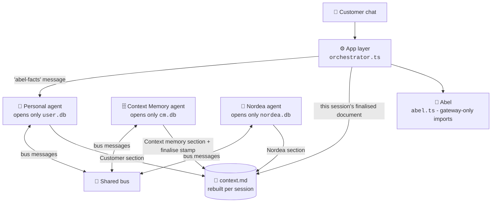

<div align="center">

# 🗄️ The Banking Context Cabinet

**Three agents, three databases, one shared document - and the customer decides what gets stored.**

*A Nordea × Aalto University mobile banking concept - `instinct-prototype-v2` branch*

[](https://nodejs.org)
[](https://www.typescriptlang.org)
[](https://nodejs.org/api/sqlite.html)
[](https://react.dev)
[](https://vite.dev)
[](https://expressjs.com)

[**Quick start**](#-quick-start) · [**The idea**](#-the-idea-in-30-seconds) · [**How a session works**](#-how-a-session-works) · [**Features**](#-features) · [**Routes**](#-routes) · [**Checks**](#-checks) · [**Known limits**](#-known-limits)

</div>

> [!NOTE]
> This branch is a **research prototype** exploring a three-agent architecture. It is not merged into `main`. All bank data, partners and customers are fictional.

## 💡 The idea in 30 seconds

Instead of one assistant reading one database, this branch splits the work between **three agents**. Each agent opens **only its own database** - that rule is enforced by a source-scan test, not by convention. Agents never read each other's stores; they talk through **bus messages** and a shared working document, **`context.md`**, that is rebuilt for every customer session.

<table>
  <tr>
    <td width="33%" valign="top">
      <h3>🙋 Personal agent</h3>
      Works for the customer. Opens <b>only the User DB</b>. Answers chat from the finished <code>context.md</code>, shares goals by title, and keeps raw detail on the customer's side.
    </td>
    <td width="33%" valign="top">
      <h3>🗄️ Context Memory agent</h3>
      Owns the cabinet. Opens <b>only the Context Memory DB</b>. Finalises each session's document, stores accepted items, and runs decay maintenance - by <i>asking</i> the other agents, never by opening their databases.
    </td>
    <td width="33%" valign="top">
      <h3>🏦 Nordea agent</h3>
      Works for Nordea. Opens <b>only the Nordea DB</b>. Answers with aggregates and proposes goal-relevant insights; raw transactions never leave its store.
    </td>
  </tr>
</table>

**Abel**, the in-app assistant, joins the same pattern: its User DB facts come from the personal agent *by message*, and it reads only the current session's finalised `context.md`. Every figure in an Abel reply must come from code or that context - otherwise the reply is sent back to be fixed.



## 🚀 Quick start

**You need:** [Node.js](https://nodejs.org) 22.13 or newer (the stores use the built-in `node:sqlite`, unflagged from 22.13). An AI key is optional for a first look.

```bash
# 1. Get the code and switch to this branch
git clone https://github.com/coolkowkank/Nordea-x-Aalto-Banking-.git
cd Nordea-x-Aalto-Banking-
git checkout instinct-prototype-v2

# 2. Install
npm install --legacy-peer-deps

# 3. Load the fictional bank data (see seed/README.md)
python3 scripts/load_data.py seed/demo --target file   # local file store; drop --target file to use Supabase

# 4. Run without an AI key
LLM_PROVIDER=mock npm run dev
```

Open **http://localhost:3000/arch.html** for the three-agent demo UI. The developer monitor at **http://localhost:3000/dev-monitor.html** is off unless you start with `DEV_MONITOR=1` (it shows private cards, so it is a laptop-only tool). Without `LLM_PROVIDER=mock`, Abel uses Gemini (`GEMINI_API_KEY`) or an OpenAI-compatible provider, as on `main`.

| Script | What it does |
|---|---|
| `npm run dev` / `npm start` | Start the server and app on port 3000 |
| `npm run build` | Build the frontend with Vite |
| `npm run lint` | Type-check with TypeScript (`tsc --noEmit`) |
| `npm test` | Run the bank-records tests |
| `npm run check:feed` | Validate the Nordea feed CSV applies cleanly |
| `npm run test:arch` | Run the three-agent architecture checks |
| `npm run test:e2e` | End-to-end proof the app, `/arch.html` and the monitor are one machine (boots a real server on a scratch dataset) |

## 🔄 How a session works

1. The customer's first question of a session opens a **build round**; `context.md` starts empty - nothing carries over from earlier sessions.
2. The **personal agent** writes the Customer section: the shareable part of the User DB (goals by title, never raw detail).
3. The **Context Memory agent** retrieves what is relevant from `cm.db` and writes the Context memory section.
4. The **Nordea agent** adds relevant aggregates from `nordea.db`.

With a provider configured (`GEMINI_API_KEY` or `LLM_PROVIDER=openai`), the CM and Nordea agents also **reason with an LLM**: each model gets tools for its own database only, proposes the round's retrieval plan and match terms, and code validates the proposal and owns numbers, evidence, risk and every write. Without a key the scripted behaviour runs unchanged (that is also what the tests use).
5. The Context Memory agent **finalises** the document and stamps it with the session id. Every later question in that session is answered from that document.
6. If an agent is off or the cabinet is parked, no round runs and no other session's document is served - the app says plainly that shared context is unavailable.
7. Accepted knowledge is stored in `cm.db`; decay maintenance re-checks it before reuse (below).

## ✨ Features

#### 🗂️ The shared document

| | Feature | How it works |
|:-:|---|---|
| 📄 | **Per-session `context.md`** | Rebuilt for every customer session, rendered from structured rows - never parsed back. |
| ✍️ | **Section ownership, enforced** | One writer module per section; the same source-scan that pins each agent to its own database pins the sections. |
| 🔎 | **Session stamping** | A document is served only when its `sessionId` matches the current session; a stale document is never wiped and never leaked across sessions. |

#### 🚦 Risk and permissions

| | Feature | How it works |
|:-:|---|---|
| 📏 | **Risk decided by code rules** | High risk always waits for the customer: offers, sharing beyond the three agents, inferences, sensitive topics. Never the agent's judgement. |
| 🧾 | **Observed vs inferred, derived** | "Observed" comes from the evidence (transaction ids + a total, or the customer's own words) - never trusted from the proposer's own flag. |
| 🎚️ | **Standing permissions** | Set once via `POST /api/arch/:uid/permissions`. Until then every proposal waits in merge review; afterwards low and medium risk items are stored automatically - always logged, explainable and disputable. |

#### ⏳ Decay maintenance

| | Feature | How it works |
|:-:|---|---|
| 🔁 | **Re-check before reuse** | The CM agent detects possible decay from stored evidence and asks the owning agent to confirm - it never opens another agent's database. |
| 🧮 | **Five decay signals** | A changed total; churned transactions (a hash of the full id set is compared like with like, so large accounts don't false-flag); age past 30 days without verifiable evidence; evidence that was never stored; and a goal the customer removed, which flags its entries too. |
| 🚩 | **Plain-language flags** | The customer is told which entries went stale, why, and whether refreshed figures were stored automatically or wait in merge review. |

#### 🧑‍⚖️ Customer control

| | Feature | How it works |
|:-:|---|---|
| 💬 | **Explain** | Every cabinet item answers "why do you know this?" with its source and the message that proposed it. |
| ✋ | **Dispute** | The customer can mark an item wrong; from then on it is filtered out of the context Abel receives, so its figures fail Abel's grounding check. The stored document keeps the `[disputed]` mark and the history. |
| ↩️ | **Undo** | Automatically stored items can be undone per entry; manually reviewed items are disputed instead, so provenance survives. |
| ⏸️ | **Park and agent switches** | Parking the cabinet or switching an agent off silences that part of the pipeline without deleting anything. An off switch gates the agent's **reasoning** only - control writes from the app still land in its database. |

#### 💬 Abel, inside the architecture

| | Feature | How it works |
|:-:|---|---|
| 📨 | **Facts by message** | Abel's User DB facts come from the personal agent answering an `abel-facts` message - the app layer opens no agent store on this path (pinned by a source-scan test). |
| 📄 | **Session document only** | Abel receives the current session's finalised `context.md`; a missing or other-session document is rebuilt when possible and otherwise not served. |
| 🔢 | **Grounded numbers** | Figures from the shared context join the same grounding guard as tool results: a number Abel can't source sends the reply back to be fixed. |

## 🛣️ Routes

All under `/api/arch/:uid/` (`src/server/arch/routes.ts`):

| Route | Purpose |
|---|---|
| `GET state` | Cabinet, agents and document state for the demo UI |
| `POST chat` | Session chat answered from the session's document |
| `POST goals` | Add a customer goal |
| `POST permissions` | Set standing permissions (`reviewLevel: 'all' \| 'high'`) |
| `POST agent-query` | Ask an agent a direct question |
| `POST personal-agent/connect` · `POST personal-agent/disconnect` | Swap between the in-app and an external personal agent |
| `POST sync` · `POST airlock/:batchId/approve` · `POST airlock/:batchId/reject` | Sync ingestion through the airlock; approve or reject what enters the User DB |
| `POST nordea/contribute` | Run a contribution round (Nordea proposals) |
| `GET review` · `POST review/:messageId/accept` · `POST review/:messageId/reject` | The merge-review queue |
| `GET entries` · `GET entries/:entryId/explain` · `POST entries/:entryId/dispute` · `POST entries/:entryId/undo` | Cabinet entries: list, explain, dispute, undo |
| `POST cabinet/park` · `POST cabinet/resume` | Park or resume the whole cabinet |
| `POST agents/:agent/off` · `POST agents/:agent/on` | Switch one agent off or on |
| `DELETE db/:which` | Delete a database (customer-driven) |

## ✅ Checks

| Check | Command | Covers |
|---|---|---|
| Architecture tests | `npm run test:arch` | 207 assertions: the one-database rule (source scan), per-session documents, reactive rounds, risk rules, permissions, decay, undo, the Abel integration, the G4 LLM planning path (mock provider) and the negative cases |
| End-to-end | `npm run test:e2e` | 19 checks over a real booted server: a goal shows in all views, a review decision changes what the chat answers from, a bank import updates app + arch + monitor, session and top-up rounds run, and no code reads the old store |
| Type check | `npm run lint` | `tsc --noEmit` across the app |
| Bank records | `npm test` | Feed loading and bank-record maths |
| Feed CSV | `npm run check:feed` | The Nordea feed CSV applies cleanly |

## ⚠️ Known limits

<details>
<summary>What this prototype does <b>not</b> do</summary>

- **Figures are labelled "of related spending"** - goal matching uses category and description keywords, so a saving goal's figure is the related spending, not a true savings-transfer balance.
- **Single process.** The round engine, bus and stores run in one Node process; `node:sqlite` files sit under the data dir. No distribution, no queues.
- **No real external agent.** The "external personal agent" is a local client script (`scripts/personal-agent-client.ts`) exercising the same bus protocol.
- **No live bank.** All account data is fictional, loaded with `scripts/load_data.py` (see `seed/README.md`).
- **Demo UI.** `public/arch.html` and `public/dev-monitor.html` are demonstration surfaces, not the polished app from `main`.

</details>

<details>
<summary>📁 Project structure (this branch adds <code>src/server/arch</code>)</summary>

```
src/server/arch/
  agents/       personal.ts · cm.ts · nordea.ts (each opens only its own store)
  store/        userStore · cmStore · nordeaStore · contextStore · busStore (node:sqlite)
  orchestrator.ts  rounds, sessions, decay maintenance, Abel shared context
  rounds.ts        round engine        dispatcher.ts   bus delivery
  risk.ts          code-rule risk levels
  text.ts          keyword and category matching
  routes.ts        /api/arch/:uid/* HTTP surface
public/
  arch.html        three-agent demo UI
  dev-monitor.html developer monitor
scripts/
  test-arch.ts     the architecture assertions (count in the Checks table)
  load_data.py     fictional bank data loader (see seed/README.md)
```

The main Abel app (`src/server/abel.ts`, cabinet UI, access gateway) is shared with `main`; this branch wires Abel's chat into the three-agent context described above.

</details>
